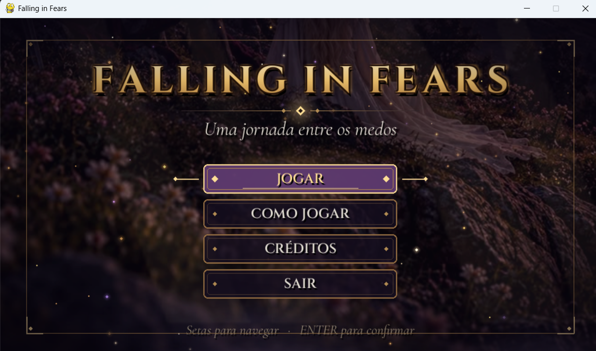
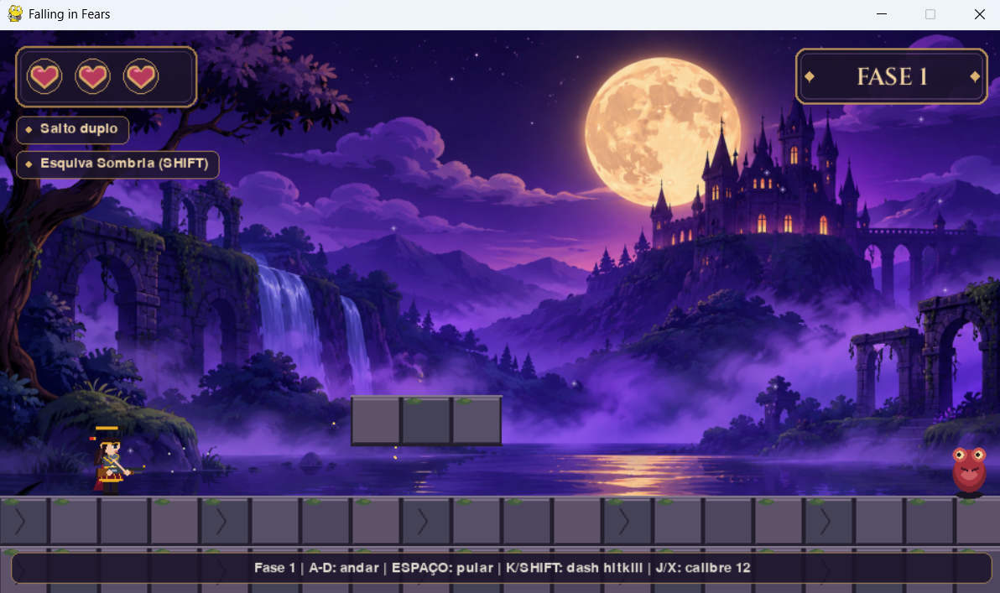
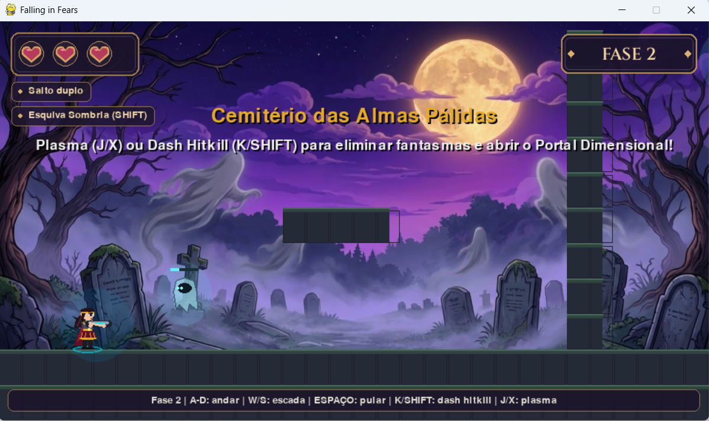
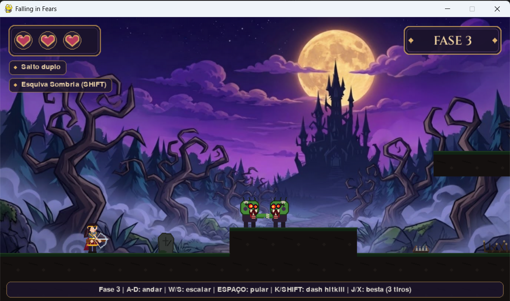
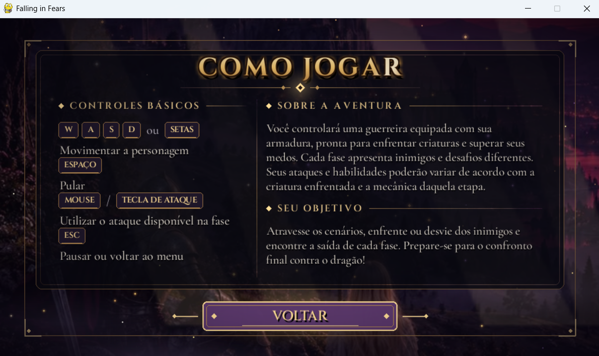
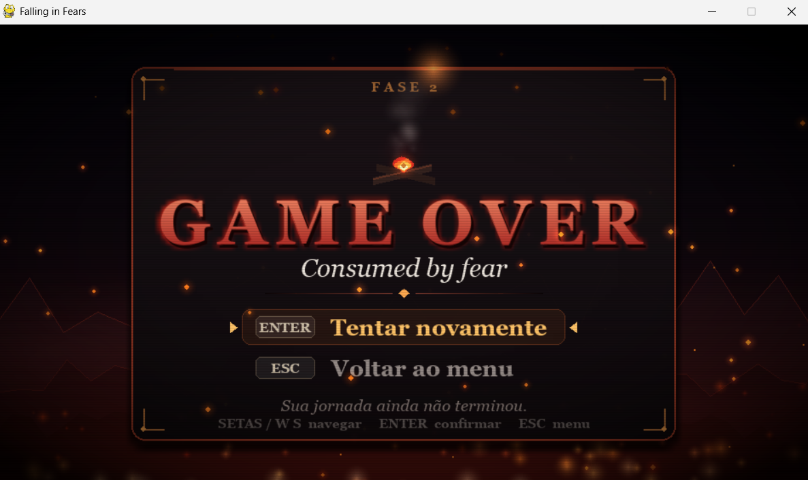

# Falling in Fears - A3 Usabilidade, desenvolvimento web, mobile e jogos

<div style="text-align: justify;">
  Jogo desenvolvido para a A3 da UC de Usabilidade, desenvolvimento web, mobile e jogos do curso de Engenharia de Software da Universidade São Judas Tadeu.
</div>

## Identificação

**Nome do jogo:** Falling in Fears

**Disciplina:** Usabilidade, desenvolvimento web, mobile e jogos

**Professores:** Patricia Vitorino Gomes e Fabio Tadeu Doro

**Integrantes:**

- Adriel Massagli de Araujo - RA 824212280
- Fernanda Rodrigues Coelho - RA 82427370
- Rayssa Viana Fernandes - RA 824222502
- Lucas Almeida Ferreira dos Santos - RA 82620608
- Thiago Yuki Saneshima - RA 82425638
- Wadja Láyza Gabrielle dos Santos Ferreira - RA 825145905

> O nome escolhido faz referência a `falling in love` e ao medo que a personagem principal enfrenta. A guerreira precisa reencontrar a princesa perdida enquanto encara fisicamente seus maiores medos.

## Descrição

### Resumo

Um jogo de ação e aventura ambientado em um reino mágico onde feitiços dividem espaço com problemas e estéticas da vida moderna. Quando uma princesa desaparece misteriosamente durante a noite, sua amada - uma jovem guerreira - parte em uma jornada de resgate através de florestas encantadas, bosques sombrios e cemitérios assombrados. Para alcançar o castelo protegido por um dragão imponente, ela precisará enfrentar criaturas mágicas e sobreviver aos maiores medos e inseguranças materializados pelo reino.

### Premissa da história

Em um mundo de fantasia, a magia convive com celulares encantados, cafeterias de poções e burocracias reais. O desaparecimento da princesa quebra a paz do reino e leva sua parceira, uma guerreira habilidosa, mas marcada por medos, a iniciar uma busca por conta própria. Conforme avança rumo à torre final, ela descobre que a magia da floresta reage à sua mente e transforma ansiedades e traumas em obstáculos mortais.

## Como rodar

### Requisitos

- Python 3.x
- Sistema operacional Windows, Linux ou macOS
- Biblioteca Pygame CE

### Instalação e execução

No terminal, a partir da pasta raiz do projeto:

```bash
python -m venv .venv
```

Ative o ambiente virtual:

```bash
# Windows (PowerShell)
.venv\Scripts\Activate.ps1

# Windows (Prompt de Comando)
.venv\Scripts\activate.bat

# Linux/macOS
source .venv/bin/activate
```

Instale as dependências e execute o jogo:

```bash
python -m pip install -r requirements.txt
cd "A3 - GAME"
python main.py
```

> Execute o jogo a partir da pasta `A3 - GAME`, pois os mapas e os recursos de `assets` são encontrados por caminhos relativos ao projeto.

## Controles

| Tecla | Ação |
|:---:|---|
| A / ← | Andar para a esquerda |
| D / → | Andar para a direita |
| W / ↑ | Subir escadas, trepar/escalar ou preparar salto em situações aplicáveis |
| S / ↓ | Descer escadas ou descer por superfícies trepáveis |
| Espaço / W / ↑ | Pular; com o salto duplo desbloqueado, permite um segundo salto no ar |
| J / X | Atacar com a arma da fase: plasma, besta ou espingarda |
| K / Shift esquerdo / Shift direito | Ativar avanço ou esquiva sombria |
| Enter | Confirmar ou continuar nas telas com essa instrução |
| Escape | Voltar ao menu ou sair de uma tela final |
| Clique esquerdo | Interagir com botões do menu |

## Regras do jogo

### Objetivo

A guerreira deve atravessar as fases, derrotar os chefes regionais e completar a batalha final para resgatar a princesa.

### Pontuação e recuperação

O projeto não possui um placar com pontuação numérica. O progresso é representado por:

- inimigos derrotados;
- chefes eliminados;
- relíquias coletadas;
- itens restauradores de vida encontrados no cenário;
- desbloqueio de habilidades;
- avanço pelas fases e pela progressão da história.

### Vida

- A personagem começa com 3 pontos de vida.
- Ao sofrer dano, perde 1 ponto de vida.
- Existe um período curto de invencibilidade após ser atingida.
- Partes de cura podem recuperar 1 ponto de vida, enquanto outros itens podem restaurar 2 pontos.
- Quando a vida chega a zero, a tela de Game Over é exibida.

### Vitória e derrota

- O jogador vence uma fase ao derrotar o chefe ativo da região.
- Após a vitória, o portal fica desbloqueado.
- Entrar no portal libera o avanço para a fase seguinte.
- Antes da derrota do chefe, a passagem permanece selada.
- O jogador perde quando os pontos de vida chegam a zero.
- A vitória final ocorre ao concluir a jornada e o desfecho da batalha contra o dragão.

## Tecnologia

- **Linguagem:** Python
- **Biblioteca principal:** Pygame CE
- **Dependência declarada:** `pygame-ce`
- **Justificativa:** Pygame foi escolhido por ter sido apresentado em aula, facilitando o desenvolvimento, e por oferecer recursos adequados ao jogo, como janela, entrada por teclado e mouse, áudio, animações em tempo real e execução multiplataforma.
- **Organização:** cenas, entidades, mapas, sistema de HUD, áudio e núcleo do jogo estão separados em pacotes dentro de `A3 - GAME`.

## Divisão de tarefas

| Responsabilidade | Integrante |
|---|---|
| Desenvolvimento da Fase 1 | Thiago |
| Desenvolvimento da Fase 2 | Adriel |
| Desenvolvimento da Fase 3 | Wadja |
| Desenvolvimento da Fase 4 / fase final | Lucas |
| Interface visual e identidade artística | Rayssa |
| Documentação e testes | Fernanda |


## Créditos

### Fontes visuais

#### Imagens geradas por inteligência artificial

As imagens utilizadas na composição dos cenários e da ambientação do jogo foram geradas com o auxílio da ferramenta de inteligência artificial Google Gemini, a partir de descrições e comandos elaborados pelo grupo.

Os arquivos utilizados no desenvolvimento do projeto são:

- `fundo_fase1.png`;
- `fundo_fase2.jpeg`;
- `fundo_fase3.jpeg`;
- `fundofase4.jpeg`;
- `fundo_introducao.jfif`.

**Ferramenta utilizada:**

GOOGLE. *Gemini*. Google, [s. d.]. Disponível em: [https://gemini.google.com/](https://gemini.google.com/). Acesso em: 20 nov. 2026.

#### Fontes tipográficas

Foram utilizadas duas famílias tipográficas no desenvolvimento da identidade visual e das interfaces do jogo:

**a) Cinzel**

Criada por Natanael Gama e distribuída sob a licença SIL Open Font License 1.1.

GAMA, Natanael. *Cinzel*. GitHub, [s. d.]. Disponível em: [https://github.com/NDISCOVER/Cinzel](https://github.com/NDISCOVER/Cinzel). Acesso em: 20 nov. 2026.

**b) Cormorant Garamond**

Criada por Christian Thalmann, da Catharsis Fonts, e distribuída sob a licença SIL Open Font License 1.1.

THALMANN, Christian. *Cormorant*. GitHub, [s. d.]. Disponível em: [https://github.com/CatharsisFonts/Cormorant](https://github.com/CatharsisFonts/Cormorant). Acesso em: 20 nov. 2026.

#### Recursos desenvolvidos pelo grupo

Os seguintes elementos foram desenvolvidos pelo próprio grupo durante a implementação do jogo:

- Programação e estruturação do jogo utilizando Python e Pygame;
- Desenvolvimento das interfaces e telas do jogo;
- Implementação dos cenários e elementos decorativos por meio de código;
- Criação de efeitos visuais, incluindo partículas, névoas, brasas e iluminação;
- Implementação dos elementos visuais das fases, plataformas e demais componentes da ambientação.


### Fontes sonoras

As músicas das fases são disponibilizadas sob licença CC0 no [OpenGameArt.org](https://opengameart.org/). Os créditos e avisos informados nas páginas dos recursos são mantidos abaixo:

- [Prologue Theme](https://opengameart.org/content/prologue-theme) — música de Cleyton Kauffman ([SoundCloud](https://soundcloud.com/cleytonkauffman/)).
- [Mysterious Clock](https://opengameart.org/content/mysterious-clock).
- [Battle Theme A](https://opengameart.org/content/battle-theme-a) — atribuição: [cynicmusic.com](https://cynicmusic.com/) e [pixelsphere.org](https://pixelsphere.org/).
- [Medieval: King's Feast](https://opengameart.org/content/medieval-kings-feast).
- [Game Over](https://opengameart.org/content/game-over-8) — o autor solicita ser creditado como “Umplix”, caso seja dado crédito.
- [Medieval: Victory Theme](https://opengameart.org/content/medieval-victory-theme).
- [Medieval: Rejoicing](https://opengameart.org/content/medieval-rejoicing).

Os efeitos sonoros sintetizados em tempo de execução estão implementados em `A3 - GAME/sistemas/sons.py`.

## Uso de IA

Foi utilizada IA como ferramenta auxiliar de desenvolvimento, incluindo o GitHub Copilot e o Claude. Essas ferramentas foram empregadas principalmente para apoiar a implementação técnica e colocar em prática ideias da equipe.

As ideias, decisões de projeto, correção e realização dos testes, além da identificação e resolução dos bugs, foram autorais e realizadas pela equipe. O código gerado com apoio das IAs foi revisado pela equipe antes de ser utilizado.

## Capturas de tela

<div>
  
</div>

**Menu principal**

<div>
  
</div>

**Jogabilidade da Fase 1**

<div>
  
</div>

**Jogabilidade da Fase 2**

<div>
  
</div>

**Jogabilidade da Fase 3**

<div>
  
</div>

**Tela de como jogar**

<div>
  
</div>

**Tela de Game Over**
